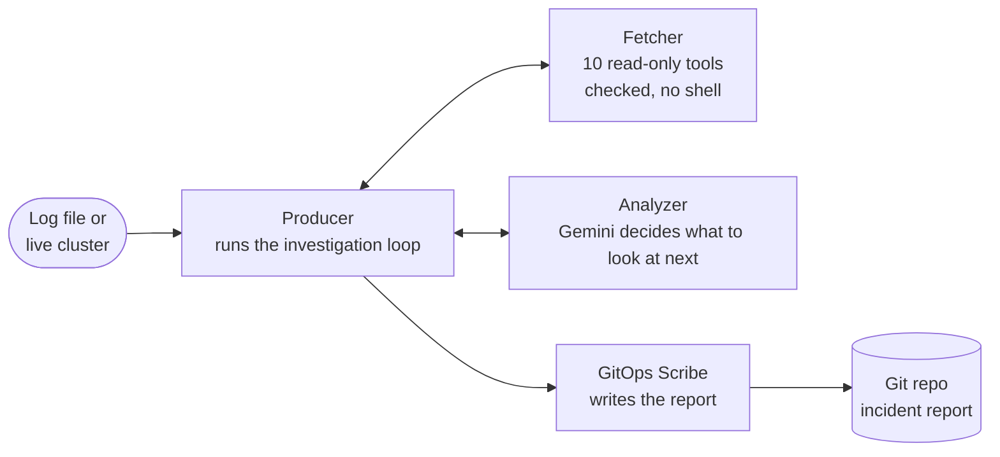
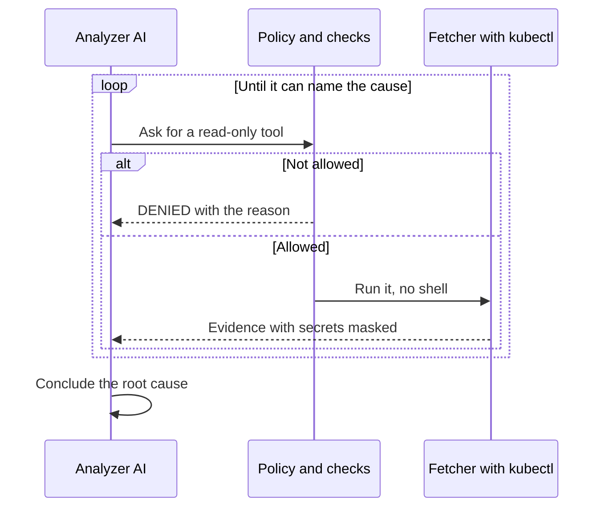

<h1 align="center">Log Analyzer</h1>

<p align="center">
<b>An agentic AI on-call engineer for Kubernetes.</b><br/>
It investigates an incident on its own, explains the root cause, and files the report in Git.
</p>

> It can look at your cluster. It has no way to change it.

## What it does

| Without it | With it |
|---|---|
| Someone reads thousands of log lines and runs `kubectl` by hand | The agents collect the evidence and decide what to check next |
| The cause lives in one person's head | A root cause with a severity, P0 (critical) to P3 (low) |
| The write-up happens later, or never | A markdown incident report, committed to Git |

## See it work



Real output from a run on a 216 KB Linux syslog (log-file mode):

```
LOG ANALYSIS COMPLETE - ISSUE COMMITTED TO GIT
Incident File  : .log-analyzer/incidents/2026-11-11-P1-security-anomaly-auth-surge-in.md
Severity       : P1
Root Cause     : Brute force credential stuffing attack, automated SSH scanning, or invalid authentication signatures.
```

## Why it is agentic

An *agent* is a program that decides and acts, not just answers. Here, four of them work together:



- **It chooses its own next step.** The AI picks which of 10 read-only tools to call, reads what comes back, and asks for more until it can name the cause (multi-turn function calling).
- **Four agents, one loop.** Producer, Fetcher, Analyzer and GitOps Scribe pass typed messages, and a state machine keeps the investigation in order.
- **Autonomy with a leash.** Caps on tool calls (12), follow-up rounds, tokens and model calls, plus a circuit breaker after repeated failures.
- **Guardrails in code, not hopes.** Every request passes a policy check before it runs: right namespace only, no secrets ConfigMap by default, no repeated calls.
- **Tested like software.** 8 prompt-injection attack cases, all defended; a fake "obedient" AI that proves the code blocks forbidden requests; offline replay in CI.
- **A human decides.** Fixes are written as text suggestions. The approver denies every action by default.

## Quick start

Requires Go 1.24 or newer and `git`. Live mode also needs `kubectl` access and a `GEMINI_API_KEY`.

**1. Analyze a log file** (no cluster, no API key):

```bash
go run ./cmd/analyzer/main.go --log-file=/path/to/app.log
```

The report is saved in `~/log-analyzer-incidents/.log-analyzer/incidents/`, its own small Git repo. Change the place with `--git-repo`.

**2. Investigate a live cluster:**

```bash
export GEMINI_API_KEY="your-key"
go run ./cmd/analyzer/main.go --namespace=production --service=payment-service \
  --symptom="HTTP 504 and pods crashing" --since=2h
```

Add `--dry-run` to print the `kubectl` commands instead of running them.

**3. Run it inside Kubernetes:**

```bash
make docker-build            # push the image to a registry your cluster can reach
kubectl create secret generic gemini-key --from-literal=GEMINI_API_KEY="your-key"
helm install inv1 deploy/helm/log-analyzer --set gemini.existingSecret=gemini-key \
  --set investigation.namespace=production --set investigation.service=payment-service
kubectl logs -f job/inv1
```

The chart grants read-only access, and not the secrets ConfigMap by default.

## What is in each report

A file named `YYYY-MM-DD-<severity>-<slug>.md` with the severity, root cause, evidence and recommendations, committed as `incident(P1): <title>`. Add `--branch` to commit on a separate branch.

The AI sorts causes into six groups: out of memory, crash loop from bad settings, image pull failure, failing health check, database lock, or no fault. Log-file mode recognizes patterns such as out-of-memory, panics, crash loops, 5xx cascades, database locks, full disks, expired certificates and login attacks.

## Safety layers

| Layer | What it does |
|---|---|
| Untrusted-data delimiters | The AI is told log text is data, never orders |
| Fixed tools | 10 read-only tools; a test fails if a write tool is added |
| Parameter checks | Patterns, length limits, no shell metacharacters |
| Policy | Right namespace, no secrets ConfigMap by default, at most 12 tool calls, no repeats |
| Redaction | Secrets are masked before anything is saved |
| Cost limits | Token and call limits, and a circuit breaker |
| No write path | An approver that denies everything is the default |

More: [docs/SECURITY.md](docs/SECURITY.md)

## Built with

Go, Gemini API (function calling), kubectl, Git, Docker, Helm, GitHub Actions.

## Configuration

| Setting | Meaning |
|---|---|
| `GEMINI_API_KEY` | Gemini key (environment variable, never in code) |
| `GEMINI_MODEL` or `--model` | Model name; the default is in `internal/llm/defaults.go` |
| `LOG_ANALYZER_MAX_CALLS`, `LOG_ANALYZER_MAX_TOKENS`, `LOG_ANALYZER_MAX_TOTAL_TOKENS` | Cost limits; 0 turns one off |

All settings: [docs/CONFIG.md](docs/CONFIG.md)

## Develop

```bash
make ci           # the full check, same as GitHub; free, needs no key
make hooks        # run it before every git push
make check-model  # can my key use this model?
make eval-live    # re-run the attack tests on the current model (costs money)
```

## Project layout

```
cmd/analyzer      the program
cmd/eval          attack tests against recorded or live AI answers
internal/agent    producer, fetcher, analyzer, git agent
internal/toolbox  the 10 read-only tools, validation, policy
internal/redact   secret masking
internal/llm      Gemini client, recorder, cost limits
internal/protocol messages between agents
internal/ttlmap   map whose idle entries expire
evals/            attack cases and results
deploy/helm       Helm chart
docs/             SECURITY.md, CONFIG.md, ROADMAP.md
testdata/         sample logs
incidents/        reports written by early runs
```

## Limits and roadmap

- Early stage: tested on 8 hand-written attack cases, one model, one run. The model resisted them even without the code guards, so the guards are insurance, proven by deterministic tests.
- The AI can be wrong. A human should review every report before acting.
- Masking is pattern-based, so unknown secret formats can slip through.
- Logs are sent to the Gemini API, so they leave your environment.
- Data in the same namespace stays readable. Run with a read-only Kubernetes account.
- It suggests fixes and never applies them.
- Reports are stored outside the repo and are not backed up unless you push that folder.
- Model names expire. Keep `--model` current; free Gemini tiers have low limits.
- The Docker image and Helm chart are new and have not run on a real cluster yet.
- Not enterprise-ready yet: see [docs/ROADMAP.md](docs/ROADMAP.md).
