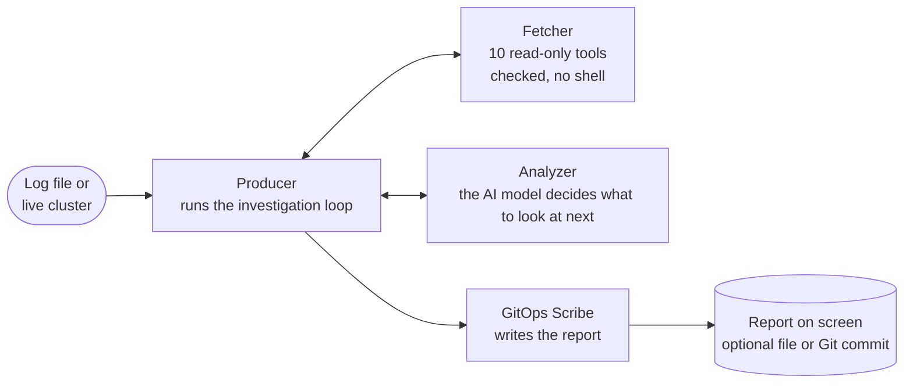
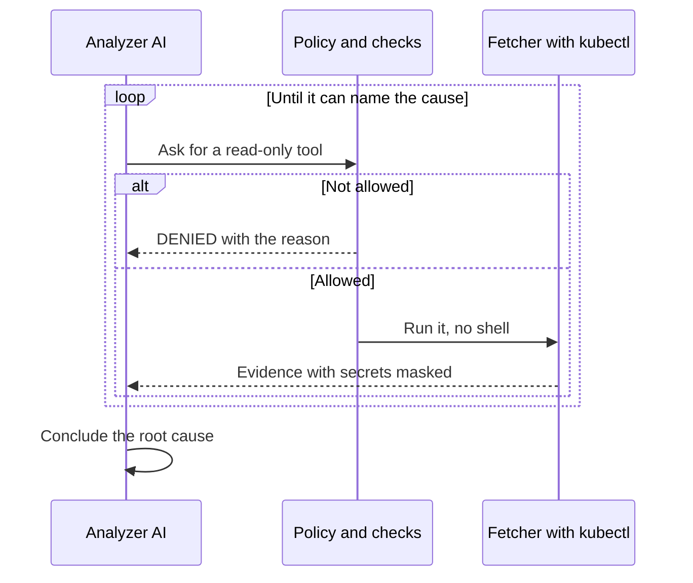

<h1 align="center">Log Analyzer</h1>

<p align="center">
<b>An agentic AI on-call engineer for Kubernetes.</b><br/>
It investigates an incident on its own, explains the root cause, and writes the report. It is shown on screen, and you can also save it as a file or in Git.
</p>

<p align="center">
<a href="https://github.com/vivekj21/log-analyzer/actions/workflows/ci.yml"></a>
<a href="https://github.com/vivekj21/log-analyzer/actions/workflows/e2e.yml"></a>
</p>

> **Built to be safe: read-only.** It can look at your cluster to diagnose problems, but it cannot change anything in it. Even if the AI is wrong or tricked, it can only run a short list of read-only commands.

## What it does

This tool finds the root cause when your app on Kubernetes has errors or is failing. Its AI agents read your logs and cluster details, then tell you the most likely root cause and how urgent it is (P0 is the most urgent, P3 the least). A short report is shown on screen. You can also save it as a file, or commit it to Git.

You can also give it just a log file. Without an AI service, built-in rules do a simpler version of the same job.

## Why trust it

- **It is made to be safe.**
  - It cannot change your cluster. It only runs read-only commands from a short allowed list.
  - Your data stays with you. Nothing is sent to an AI service unless you set one up, and you pick which one. Secrets and email addresses are masked first. See [docs/DATA-FLOW.md](docs/DATA-FLOW.md).
  - It was tested against prompt-injection tricks (so far on Gemini only).
- **It publishes its score,** including where it fails: [accuracy/RESULTS.md](accuracy/RESULTS.md).

## See it work



Real output of `go run ./cmd/analyzer --log-file app.log --llm heuristic` on a two-line sample log (the first lines):

```
## Autonomous Log Analysis
- **Diagnosed Issue:** Container Termination via OOM (Out Of Memory)
- **Severity:** P0
- **Root Cause Deduction:** Application memory usage exceeded Kubernetes pod resource limits or JVM/Runtime max heap.
```

## Why it is agentic

An *agent* is a program that decides and acts, not just answers. Here, four of them work together:



- **It chooses its own next step.** The AI picks which of 10 read-only tools to call, reads what comes back, and asks for more until it can name the cause (multi-turn function calling).
- **Four agents, one loop.** Producer, Fetcher, Analyzer and GitOps Scribe pass typed messages, and a state machine keeps the investigation in order.
- **Autonomy with a leash.** Caps on tool calls (12), follow-up rounds (10), tokens and model calls, plus a circuit breaker after repeated failures.
- **Guardrails in code, not hopes.** Every request passes a policy check before it runs: right namespace only, no ConfigMap reading by default, no repeated calls.
- **Tested like software.** 8 prompt-injection attack cases, all defended; a fake "obedient" AI that proves the code blocks forbidden requests; offline replay in CI.
- **A human decides.** Fixes are written as text suggestions. The approver denies every action by default.

## Quick start

Read this part top to bottom. Each step adds one thing, and every step after the first is optional.

**Before you start.** To run from source you need Go 1.21 or newer (it downloads the exact Go version this project needs by itself). Nothing else is needed for step 1. Later steps need: `kubectl` for a live cluster, an API key for a real AI model, `git` only if you want reports committed to Git.

### 1. Try it in one minute

You need only a log file. Nothing is installed, saved or sent anywhere:

```bash
go run ./cmd/analyzer --log-file=app.log
```

You get the report on the screen, then a short note on standard error that says where everything went. This is real output for a small sample log:

```
## Autonomous Log Analysis
- **Diagnosed Issue:** Container Termination via OOM (Out Of Memory)
- **Severity:** P0
- **Root Cause Deduction:** Application memory usage exceeded Kubernetes pod resource limits or JVM/Runtime max heap.

### Remediation Guidance
1. Increase Kubernetes memory request/limit in pod deployment specification.
...
----------------------------------------------------------------------
Where things went
  Report : shown above (this is the main result)
  File   : not saved. To keep a copy, add: --output report.md
  Git    : not committed. To commit it, add: --git-repo ~/incidents
  Privacy: the analysis ran on this computer. No log text was sent anywhere.
All options: run with --help
----------------------------------------------------------------------
```

The note appears after every run and only suggests what you did not already use. Because the note goes to standard error, `analyzer --log-file app.log > report.md` writes only the report into the file. Run `analyzer --help` for all options, grouped by purpose.

### 2. Keep the results (optional)

The report is always shown on the screen. Saving it is your choice:

| I want to | Add this | Needs |
|---|---|---|
| keep a copy as a markdown file | `--output report.md` (or `-o`) | nothing |
| keep copies in a folder, one new file per run | `--output reports/` | nothing |
| commit the report to a Git repository | `--git-repo ~/incidents` | `git` installed |
| commit to the default repository, `~/log-analyzer-incidents` | `--git` | `git` installed |
| commit on a separate branch per incident | `--git-repo ~/incidents --branch` | `git` installed |

- A folder (an existing one, or a value ending in `/`) gets a new, named file each time and never overwrites an older one. Any other value is the exact file to write, and it is replaced if it exists.
- `--git-repo` also turns `--git` on. If the folder is not yet a Git repository, it is set up for you. `--git=false` always wins.
- If saving or committing fails (for example `git` is not installed), you get one clear warning, the report on the screen is still complete, and the warning does not change the exit code. The note at the end says "NOT saved" or "NOT committed" so you cannot miss it.

### 3. Use a real AI model (optional)

Without a key, built-in rules analyze the log and nothing leaves your computer. With a key, masked log text is also sent to the model service you choose, and the note at the end names it. To keep a run on your computer even with a key set, add `--llm heuristic`.

**Your API key.** Best: keep the key in a file only you can read (`chmod 600`) and pass `--api-key-file`. In Kubernetes, use a Secret mounted as a file (the Helm chart does this). An environment variable also works, but it is not recommended for company use: anyone who can dump the environment, for example in a CI log or a debug dump, can read the key. The tool itself never prints the key.

Secrets and email addresses are masked before anything is shown, saved or sent. If the model service fails, the report still contains the rule-based part, says the model part is missing, and the command exits with an error.

**Which AI model?** You choose; nothing is tied to one company:

```bash
# Gemini (default)
go run ./cmd/analyzer --namespace=production --gemini-key-file="$HOME/.keys/gemini"
# Any OpenAI-compatible service: OpenAI, Groq, OpenRouter, Mistral, or Ollama on your own machine
go run ./cmd/analyzer --namespace=production --provider=openai --base-url=https://api.groq.com/openai/v1 --model=<model name> --api-key-file="$HOME/.keys/groq"
# Claude
go run ./cmd/analyzer --namespace=production --provider=anthropic --model=<model name> --api-key-file="$HOME/.keys/anthropic"
```

Model names change often, so only Gemini has a built-in default. Base addresses must use https (or localhost); see [docs/CONFIG.md](docs/CONFIG.md).
Status: Gemini and Groq (model `openai/gpt-oss-120b`) are tested against the real services; see [accuracy/RESULTS.md](accuracy/RESULTS.md). The Anthropic client is so far tested only against a local fake server.

### 4. Investigate a live Kubernetes cluster (optional)

Needs `kubectl`, logged in to that cluster. The tool only reads from the cluster that `kubectl` points to now, and only with read-only commands.

```bash
go run ./cmd/analyzer --api-key-file=/path/to/key --namespace=production --service=payment-service \
  --symptom="HTTP 504 and pods crashing" --since=2h
```

Add `--dry-run` to print the `kubectl` commands instead of running them. Everything from step 2 (`--output`, `--git-repo`) works here too.

### 5. Run it inside Kubernetes (optional)


```bash
make docker-build            # push the image to a registry your cluster can reach
kubectl create secret generic gemini-key --from-literal=GEMINI_API_KEY="your-key"
helm install inv1 deploy/helm/log-analyzer --set gemini.existingSecret=gemini-key \
  --set llm.mode=live --set llm.acknowledgeDataLeavesCluster=true \
  --set investigation.namespace=production --set investigation.service=payment-service
kubectl logs -f job/inv1
```

The Job prints the report to its log (`kubectl logs`) and also commits it to a Git repository inside the pod at `/data/incidents`.

In live mode the chart mounts your Secret as a read-only file, not as an environment variable. The chart's default is `llm.mode=heuristic`: nothing leaves the cluster, but it is less accurate. Live mode sends masked log text to Gemini and needs the `acknowledgeDataLeavesCluster` switch. See [docs/DATA-FLOW.md](docs/DATA-FLOW.md).

The chart grants read-only access to the investigated namespace only (`investigation.namespace`, which must already exist), and no ConfigMap access by default. Set `rbac.clusterWide=true` to allow reading every namespace; the node tool (`get_node_conditions`) needs that.

**Try it free on a throwaway local cluster** (needs Docker and k3d; no API key, it uses the built-in rule-based model via `--llm heuristic`):

```bash
make k3d-e2e     # 3 broken apps; checks each report names the right cause
make helm-k3d    # builds the image, installs the Helm chart, checks the result
```

Both create their own cluster and delete it afterwards. To run the chart with real Gemini instead (uses a little of your free quota): `GEMINI_API_KEY=... make helm-k3d-live`.

### 6. Check how accurate it is

**How accurate is it?** `make accuracy` runs small broken apps with known causes through the rule-based model and through each model service you list (`ACC_MODELS`, see the top of `scripts/accuracy.sh`), then writes the scorecard to [accuracy/RESULTS.md](accuracy/RESULTS.md), including what it does not prove. It needs the same setup as above; add `GEMINI_API_KEY` to include Gemini. The cases are split into a **dev** set (used while tuning) and a **held-out** set (never tuned against); the scorecard reports them separately. A case only counts if its fault really showed up in the cluster, and a right answer must also name the evidence. To run only some cases, one set, or to repeat each one and see how stable the answers are, set `ACC_CASES`, `ACC_SET` and `ACC_REPEAT` (also described at the top of `scripts/accuracy.sh`). `make validate-cases` checks the test apps themselves, without any model or key. How the cases work: [accuracy/README.md](accuracy/README.md).

If the rule-based model has nothing to go on, it answers `CANNOT_DETERMINE` ("cannot tell"). That is not the same as "no fault".

## What is in each report

The screen output and an `--output` file hold the same text: the issue, severity, root cause and recommendations. A Git commit holds a file named `YYYY-MM-DD-<severity>-<slug>.md` with the severity, root cause, evidence and recommendations, committed as `incident(P1): <title>`. Add `--branch` to commit on a separate branch.

The AI puts each cause into one category from a fixed list (the list is in `internal/llm/model.go`), for example out of memory, bad settings, image pull failure, failing health check, database lock or no fault. If it cannot tell, it says so (`CANNOT_DETERMINE`) instead of guessing. If the model forgets to name a category, it is asked once; if it still gives none, the report says `CANNOT_DETERMINE`.

## Safety layers

| Layer | What it does |
|---|---|
| Untrusted-data delimiters | The AI is told log text is data, never orders |
| Fixed tools | 10 read-only tools; a test fails if a write tool is added |
| Parameter checks | Patterns, length limits, no shell metacharacters |
| Policy | Right namespace, ConfigMaps not readable by default, at most 12 tool calls, no repeats |
| Redaction | Secrets are masked before anything is saved |
| Cost limits | Token and call limits, and a circuit breaker |
| No write path | An approver that denies everything is the default |

More: [docs/SECURITY.md](docs/SECURITY.md)

## Built with

Go, any of: Gemini, an OpenAI-compatible service (OpenAI, Groq, OpenRouter, Mistral, Ollama, ...) or Anthropic (all with tool calling), kubectl, Git, Docker, Helm, GitHub Actions.

## Configuration

| Setting | Meaning |
|---|---|
| `--provider`, `--model`, `--base-url` | Which model service (gemini, openai, anthropic). See [docs/CONFIG.md](docs/CONFIG.md) |
| `--api-key-file` / `LLM_API_KEY_FILE` / `LLM_API_KEY` | The key, from a file (best) or the environment, never in code. Gemini also accepts `--gemini-key-file`, `GEMINI_API_KEY_FILE`, `GEMINI_API_KEY` |
| `GEMINI_MODEL` or `--model` | Model name; the default is in `internal/llm/defaults.go` |
| `LOG_ANALYZER_MAX_CALLS`, `LOG_ANALYZER_MAX_TOKENS`, `LOG_ANALYZER_MAX_TOTAL_TOKENS` | Cost limits; 0 turns one off |

All settings: [docs/CONFIG.md](docs/CONFIG.md), or run `analyzer --help`. Output options (`--output`, `--git`, `--git-repo`, `--branch`) are in Quick start step 2.

**Where to read next:** [docs/CONFIG.md](docs/CONFIG.md) (every setting) → [docs/DATA-FLOW.md](docs/DATA-FLOW.md) (what leaves your computer, and what is stored) → [docs/SECURITY.md](docs/SECURITY.md) (how it is kept safe) → [docs/ROADMAP.md](docs/ROADMAP.md) (what is planned).

## Develop

```bash
make ci           # the full check, same as GitHub; free, needs no key
make hooks        # run it before every git push
make check-model  # can my key use this model?
make eval-live    # re-run the attack tests on the current model (costs money)
```

## Project layout

```
cmd/analyzer      the program
cmd/eval          attack tests against recorded or live AI answers
internal/agent    producer, fetcher, analyzer, git agent
internal/toolbox  the 10 read-only tools, validation, policy
internal/redact   secret masking
internal/llm      model clients (Gemini, OpenAI-compatible, Anthropic), recorder, cost limits
internal/protocol messages between agents
internal/ttlmap   map whose idle entries expire
evals/            attack cases and results
deploy/helm       Helm chart
docs/             SECURITY.md, CONFIG.md, ROADMAP.md
testdata/         sample logs
incidents/        reports written by early runs
```

## License

Apache License 2.0. See [LICENSE](LICENSE) and [NOTICE](NOTICE). To report a security problem, see [SECURITY.md](SECURITY.md). To contribute, see [CONTRIBUTING.md](CONTRIBUTING.md).

## Limits and roadmap

- Early stage: tested on 8 hand-written attack cases, one model, one run. The model resisted them even without the code guards, so the guards are insurance, proven by deterministic tests.
- The AI can be wrong. A human should review every report before acting.
- Masking is pattern-based (secrets and email addresses). Unknown secret formats and other personal data can slip through.
- In live mode, logs are sent to the model service you chose and leave your environment (unless it runs on your machine). Free tiers of some services may be read or used for training; see [docs/DATA-FLOW.md](docs/DATA-FLOW.md) before using real data.
- Data in the same namespace stays readable. Run with a read-only Kubernetes account.
- It suggests fixes and never applies them.
- Reports are stored outside the repo and are not backed up unless you push that folder.
- Model names expire. Keep `--model` current; free tiers have low limits.
- The prompt-injection tests (8 attacks) have only been run on Gemini. Other models have not been tested against them yet.
- The Helm chart and Docker image passed tests on a local k3d cluster, with the rule-based model and with live Gemini. They have not run on a real production cluster.
- Not enterprise-ready yet: see [docs/ROADMAP.md](docs/ROADMAP.md).
