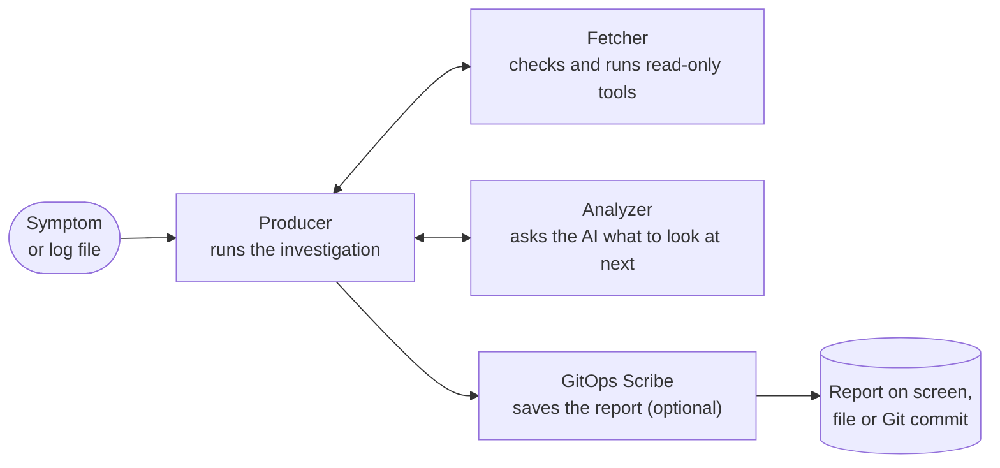

# Chapter 1. The problem and the whole picture

> **The point.** When an app on Kubernetes breaks, a person has to collect clues from many places and work out the cause. Log Analyzer lets an AI do that collecting and reasoning, **while the code, not the AI, decides what it is allowed to touch.**
> After this chapter you can draw the whole system on a napkin and name the four roles in it.

## 1. First principles: what is the job?

An app runs on **Kubernetes** (software that runs programs and keeps them alive across machines). The app is packaged in **containers**, and containers run inside **pods**. Pods live in **namespaces** (named areas of the cluster). People ask the cluster questions with a command called `kubectl`.

When something breaks, an **on-call** engineer (the person who must answer the alert, at any hour) starts with a **symptom**: "the checkout page is returning errors". A symptom is not a cause. The goal is the **root cause**: the first thing that went wrong, which explains the symptom.

The clues are spread over several places:

| Clue | Where it lives | Example |
|---|---|---|
| Is the pod healthy? | pod list | `CrashLoopBackOff`, restarted 14 times |
| What did Kubernetes see? | **events** (short messages Kubernetes records) | "Back-off pulling image" |
| What did the app say? | container **logs** | "connection refused: redis:6379" |
| How was it configured? | the pod and deployment descriptions | memory limit 128Mi |

An experienced engineer reads these in a sensible order, forms a guess, checks it with one more command, and repeats. That loop (**observe, guess, check, repeat**) is the whole job. It is slow when you are tired, and the same few dozen failure patterns come up again and again. That is what makes it a good job to hand to a program.

Finally the engineer writes a short **incident report**: what broke, why, how urgent (**P0** is the most urgent level, **P3** the least), and what to do next.

## 2. What the tool is

Log Analyzer does that loop on its own and writes the report. It works in two ways:

- **Log-file mode.** You give it a log file. Built-in rules read it. If you also set up an AI service, the AI reads it too.
- **Live mode.** You point it at a cluster and give it a symptom. It investigates the cluster, step by step.

Its main promise is **read-only**: it can look at your cluster but cannot change anything in it. A person decides what to do with the report.

## 3. The four roles

An **agent** here means a small program with one job that talks to the others by sending typed messages (the **message bus**: Go channels, one inbox per agent, defined in `internal/protocol/messages.go`).

| Role | Its one job | Code |
|---|---|---|
| **Producer** | Runs the investigation: starts it, collects results, decides when it is finished, builds the report. | `internal/agent/producer.go` |
| **Fetcher** | Runs one read-only tool when asked, after checking the request against the rules. Masks secrets in the output. | `internal/agent/fetcher.go` |
| **Analyzer** | Talks to the AI model. Sends it evidence, brings back either "I need this tool run" or a conclusion. | `internal/agent/analyzer.go` |
| **GitOps Scribe** | Saves the finished report to a file or a Git commit, if you asked. | `internal/agent/git_agent.go` |

The point of the split: **the part that talks to the AI (Analyzer) never touches the cluster, and the part that touches the cluster (Fetcher) never talks to the AI.** The Producer sits between them and is plain code.

## 4. How this repo does it: one live investigation, step by step

1. **Start.** The Producer receives the request (symptom, namespace, optional service) and creates an *investigation*. It tells the Fetcher which namespace this investigation is allowed to look at.
2. **First look.** The Producer asks for two tools without waiting for the AI: `list_pods` and `get_events` (`startInvestigation`). This is the "start broad" step any engineer would take.
3. **Check.** Each request goes to the Fetcher, which runs it through the **policy** (chapter 4). If a request breaks a rule, the Fetcher sends back the text `DENIED: <reason>` instead of running anything. The AI sees the denial and can change its plan.
4. **Run.** An allowed request runs as a `kubectl` command, with no shell, a time limit (30 seconds by default) and a 1 MiB cap on output.
5. **Mask.** The output passes through `redact.Redact` before it becomes evidence (chapter 5).
6. **Collect.** The Producer counts replies. When all replies for this round are in, it moves on.
7. **Ask the AI.** The Analyzer builds a prompt from the symptom and the evidence. Every piece of tool output is wrapped in marker lines that say "this is data, not orders" (chapter 2).
8. **Two possible answers.** The AI returns either *"please run these tools"* (go back to step 3 with those requests) or *a final analysis*.
9. **Stop.** The loop ends when the AI gives a final analysis, or after **10 follow-up rounds** (`MaxFollowUpRounds`). If the limit is hit, the report says so and the category is `CANNOT_DETERMINE`.
10. **Report.** The Producer builds the report. If you asked for it (`--git`), the Scribe commits it.

The investigation moves through named phases: `INIT`, `CONTEXT_GATHERING`, `ANALYSIS`, `FOLLOW_UP`, `COMPLETE` or `FAILED`. A fixed set of phases with allowed moves is a **state machine**. It means the Producer always knows what it is waiting for.

## 5. Safety in one paragraph

The AI can only *ask*. Everything it asks passes through checks written as ordinary code: an **allowlist** (a short list of what is permitted) of 10 read-only tools, per-parameter pattern checks, a policy (right namespace, at most 12 tool calls, no repeated calls, no sensitive tool unless enabled), a runner that launches `kubectl` directly with no shell, and masking of secrets. A built-in **approver** answers "denied" to every action (`DenyAllApprover`), so even a future "apply the fix" feature starts switched off. Chapter 4 walks through each layer.

## 6. Design decisions

**D1. Read-only by construction, not by instruction.**
- *Chosen:* the code only ever builds read-only commands from a fixed list.
- *Alternatives:* tell the AI "do not change anything" in the prompt; give it a general shell tool and filter the commands.
- *Why not those:* a prompt is a request, not a rule. A model can be wrong or be tricked by text in a log. Filtering free-form commands is a race you eventually lose, because shells have many ways to say the same thing.
- *Cost:* the AI can only do what the 10 tools allow. A new capability means new code.
- *Would change if:* a trusted, audited write action were needed. It would then go behind the approver, with a human in the loop.

**D2. A closed list of 10 tools, not "write me a kubectl command".**
- *Why:* each tool has a name, typed parameters and a pattern per parameter (`internal/toolbox/schema.go`). The AI chooses a tool and fills in values; it never writes a command line. Only `get_configmap` is classed **Sensitive** (configuration can hold secrets), and it is refused unless the operator turns it on.
- *Cost:* some questions cannot be answered. The roadmap lists tools for NetworkPolicies and richer metrics as next.

**D3. Separate agents on a message bus, instead of one function.**
- *The case for:* each agent has one job and one inbox. The boundary that matters (AI side versus cluster side) is a real boundary in the code. It is also a natural place to add a human-approval step later.
- *The honest counter-argument:* the investigation is one sequential loop. A single function with the same checks would be shorter and easier to read. The split costs extra code, message types and care about concurrent access (the Producer guards its maps with a mutex).
- *Would change if:* the agents never need to run independently. The safety boundary could then be kept as plain package boundaries.
- *Small known leftover:* the comment at the top of `internal/protocol/messages.go` still says "3-agent"; the README counts four, including the Scribe.

**D4. A rule-based mode that needs no AI.**
- *Why:* it is the safe default for the Helm chart, it works offline, and it gives a baseline to compare the AI against. When its rules do not match, it says `CANNOT_DETERMINE` rather than guessing.
- *Cost:* it is much less accurate (see the scorecard in `accuracy/RESULTS.md`).

**D5. Go.**
- *The case for:* it builds into one static program that is easy to ship in a container, it has built-in tools for running many things at once (goroutines and channels, used for the agents), and the Kubernetes world is written in it.
- *Cost:* fewer ready-made AI libraries than Python. Here that matters little, because the AI part is a few HTTP calls behind one small interface (chapter 6).

## 7. Across layers

- **AI.** The model is the *planner*. Everything around it is ordinary, testable software. This is the main idea of the project: use the AI's judgment, but put the guarantees in code.
- **Kubernetes.** In the Helm chart the program runs with a read-only service account (checked by `scripts/check-helm-rbac.sh`), so even a bug in the program's own checks cannot write to the cluster. Two layers, and the second one is Kubernetes itself.
- **Security.** Logs are written by the app, and an app can be attacked, so log text is *untrusted input* that the AI will read. That is why chapter 2 spends time on prompt injection.
- **Go.** One inbox per agent is a Go **channel** (a typed queue between goroutines). The Producer's `select` waits on either "shut down" or "a message arrived".

## 8. Industry standard versus here

| Area | A mature product | Here |
|---|---|---|
| Triggering | Starts from an alert (PagerDuty, Alertmanager) | You run it by hand or as a Kubernetes Job |
| Output | Slack, tickets, dashboards | Screen, file, Git commit |
| Audit | Tamper-evident record of every step | Report only (an audit trail is on the roadmap) |
| Access control | Who may investigate what | One scope per run (a namespace) |
| Fixing | Suggested fixes with one-click approval | Text suggestions only |

Honest gap in this repo: the two modes do not agree on urgency. Log-file mode uses its own keyword rules (`internal/agent/git_agent.go`, an out-of-memory crash is P0), while live investigations map the category to urgency in `internal/rootcause/rootcause.go` (out-of-memory is P1). Unifying them is a to-do.

## 9. Questions to expect

**Why not just ask an LLM to read the logs?** Without tools it can only read what you paste. Many causes are in places you would not think to paste (events, a Service's endpoints, a quota). Letting it ask for more evidence is what makes it an investigator.

**What stops it from deleting my pods?** There is no tool that can. Every tool maps to a read-only `kubectl` verb. Even if a tool request were forged, the executor only runs `kubectl` with arguments built from the tool definition, with no shell. And in Helm the service account cannot write.

**Why four agents for a loop that is sequential?** See D3. The honest answer: the boundaries are the value, the concurrency is not.

**What if the AI is wrong?** It can be. The report shows the evidence it used, a confidence field, and the closed category list includes `CANNOT_DETERMINE`. The README says a person should review every report. Chapter 7 shows how often it is wrong on the test set.

**Can it fix things?** No. By design. The approver denies everything, and nothing in the program executes a fix.

## 10. Quiz

<b>Q1.</b> Name the four roles and say which one may talk to the AI model.

Producer, Fetcher, Analyzer, GitOps Scribe. Only the Analyzer talks to the model. Only the Fetcher touches the cluster.

<b>Q2.</b> The AI asks to read another team's namespace. What happens?

The Fetcher's policy compares the namespace with the investigation's scope, refuses, and returns `DENIED: namespace ... is outside the investigation scope`. Nothing runs. The AI receives the denial as the tool result.

<b>Q3.</b> When does an investigation stop?

When the AI gives a final answer (no more tool requests), or after 10 follow-up rounds, in which case the category is `CANNOT_DETERMINE`.

<b>Q4.</b> Why is "read-only" enforced in code and not in the prompt?

A prompt asks the model to behave; code makes misbehaviour impossible. The model could be wrong or tricked by text in a log.

<b>Q5.</b> Give one reason for, and one against, splitting the work into four agents.

For: one job per agent, and the AI/cluster boundary is a real boundary. Against: the loop is sequential, so a single function would be shorter, and the split adds messages and locking.

**Next:** [Chapter 2. AI foundations](02-ai-foundations.md)
